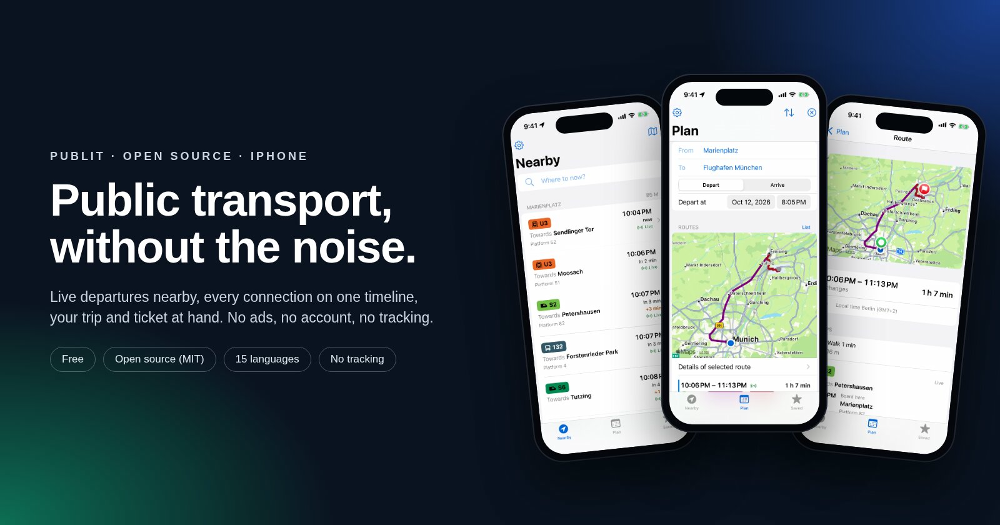
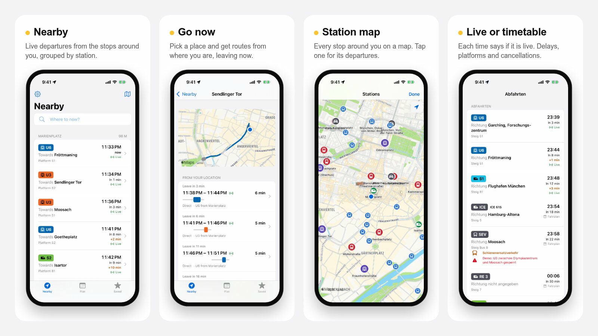
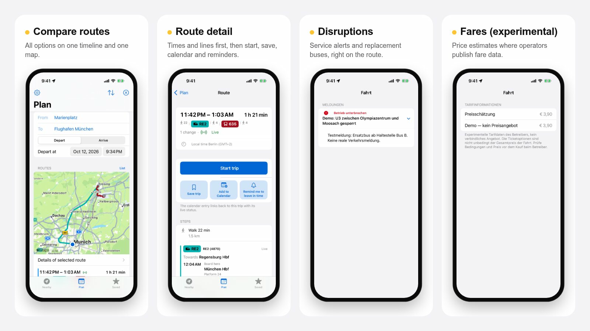
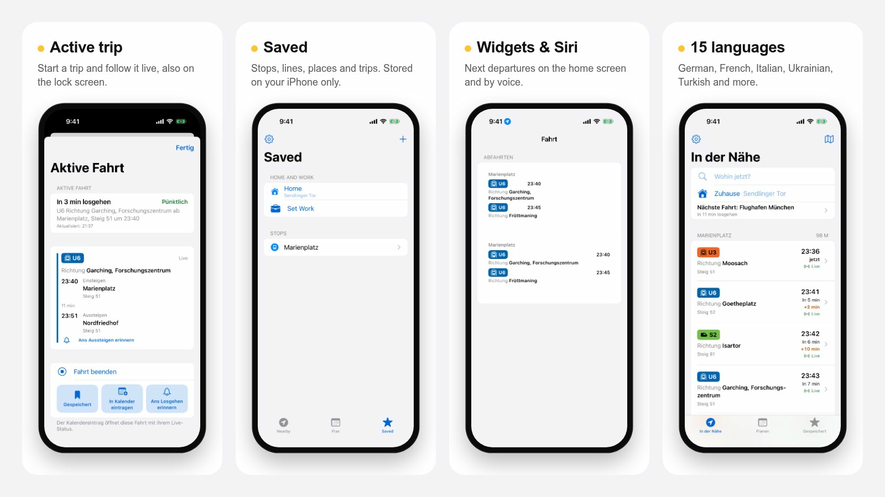

<p></p>

# Publit

**Public transport, without the noise.** A free, open-source transit app for iPhone: live departures near you, trip planning across Europe, and every connection on one timeline.

No ads, no account, no tracking.









<sub>Screenshots from the automated UI tests on the iPhone 16 Pro simulator (October 2026). Nearby, Go now, the station map and the route screens show live Transitous data with a simulated location in Munich. Departures, disruptions, fares, saved trips and the active trip use labelled demo data, partly in German.</sub>

## Status

Early prototype. Not on the App Store yet. Every commit runs core tests on Linux plus build, unit and UI tests on an iOS simulator.

## Features

- **Nearby:** live departure boards for stops within 500 m, grouped by station and refreshed every 30 s. Each time shows whether it is live or from the timetable, with delays, platforms, cancellations and the vehicle's direction. The last board appears at once while GPS and network start.
- **Station map:** all stops around you on a map; tap one for its departures.
- **Go now:** search a destination and get routes from where you are, leaving now. Recent searches are in the search sheet.
- **Plan:** routes for later, by departure or arrival time. All connections share one timeline, and a map overlays every option.
- **Route detail:** time, duration and the chain of lines at the top, then start, save, calendar and reminder in one row, then every step with platforms, stops, transfer risk and service alerts (including replacement buses), and the map.
- **Trips:** save a trip, add it to your calendar, get reminders to leave and to get off. Start a trip to follow it live in the app and on the lock screen (Live Activity).
- **Fares:** experimental fare data where operators publish it, clearly marked as an estimate.
- **Widgets and Siri:** next departures on the home screen and through App Shortcuts.
- **Offline:** last loaded departures and saved trips stay readable without a connection.
- **15 languages:** English, German, French, Italian, Spanish, Portuguese (Portugal), Dutch, Polish, Ukrainian, Romanian, Czech, Swedish, Greek, Hungarian and Turkish.
- **Saved:** stops, lines, places and trips stay on the device.

## Coverage

Publit gets its routing and timetables from [Transitous](https://transitous.org), a community-run service that combines open GTFS and GTFS-Realtime feeds. Where a city's data is missing or broken, the project fixes it upstream so that every open app benefits. Example: [`feeds/amtab-gtfsrt`](feeds/amtab-gtfsrt) converts the real-time data of the Bari city buses (AMTAB) into standard GTFS-Realtime.

## Build

Requirements: macOS, Xcode 15 or newer, [XcodeGen](https://github.com/yonaskolb/XcodeGen).

```bash
brew install xcodegen
xcodegen generate
open Publit.xcodeproj
```

Set your Apple team in Xcode under Signing & Capabilities (or `DEVELOPMENT_TEAM` in `project.yml`). Run the tests with ⌘U.

Installing a new version on your own iPhone: [docs/iphone-update.md](docs/iphone-update.md). Changes per version: [CHANGELOG.md](CHANGELOG.md).

```
Sources/
  App/        entry point, tabs, app info
  API/        Transitous client
  Models/     API models, line styling
  Location/   CoreLocation wrapper
  Stores/     favourites, trips, tickets (off for now), search history
  Tickets/    ticket passes: recognition, pass card, Wallet export (built, not wired in yet)
  Util/       polyline decoder, formatting
  Views/      Nearby, Plan, Route detail, Trips, Saved
  Intents/    App Shortcuts and Siri
  Notifications/ reminders and Live Activities
Widgets/      home-screen widgets
Tests/        unit, localization and UI tests with recorded fixtures
feeds/        data converters contributed to Transitous
services/     pass-signer: optional Apple Wallet signing service
```

## Data and attribution

Routing and timetables: [Transitous and its data sources](https://transitous.org/sources/). Map data © [OpenStreetMap contributors](https://www.openstreetmap.org/copyright). Publit follows the [Transitous API policy](https://transitous.org/api/): open source, non-commercial, identifying User-Agent, visible attribution.

Publit is an independent project and does not use code, assets or data from other transit apps.

## Roadmap

- Tickets as passes: add a PDF, photo or screenshot, Publit reads it on the device, you check the details, the code is ready for the gate. Built in `Sources/Tickets` with tests and demo screens, not wired into the app yet. See [docs/tickets.md](docs/tickets.md). The first ticket version stays switched off (`Features.tickets`).
- Live Activity updates via push while the app is closed
- Performance profiling on physical devices (Instruments)
- Native-speaker review of all translations
- watchOS companion
- Line view with live vehicle positions
- More cities with real-time data, starting with Bari

## Contributing

See [CONTRIBUTING.md](CONTRIBUTING.md).

## License

MIT, see [LICENSE](LICENSE).
