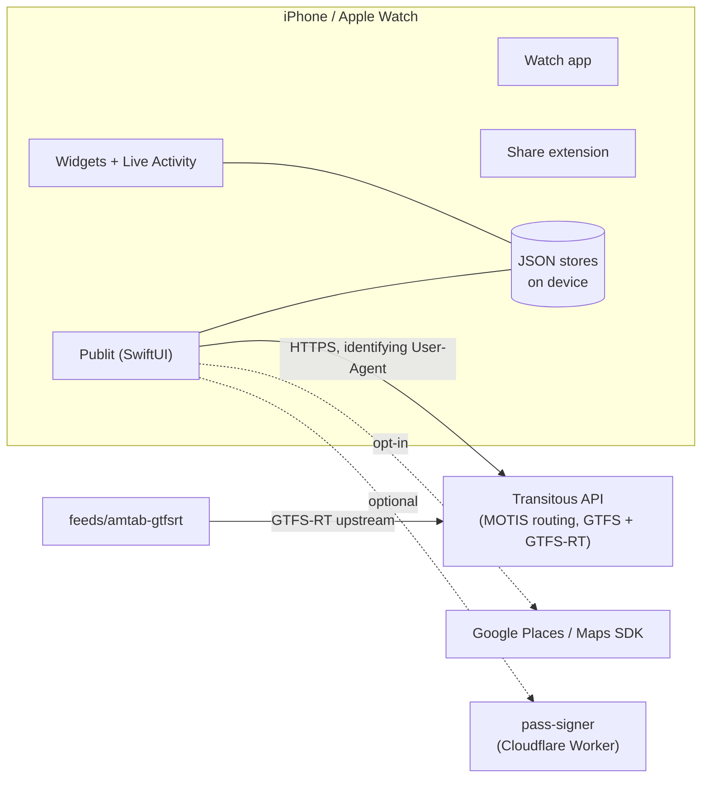

# Publit

## iOS and Android

Publit supports iOS and Android. **iOS uses Apple Maps; Android uses MapLibre.**

[Download the Android APK (development build)](https://github.com/elija-7580/Publit-Android/releases/tag/native-latest) · [Android source](https://github.com/elija-7580/Publit-Android/tree/native-android) · [iOS source](https://github.com/elija-7580/Publit) · [Website](https://publit.eu)

Android remains in development. APK availability does not imply completed device QA or a Google Play release.

**Public transport, without the noise.** A free, open-source transit app for iPhone and Apple Watch, built on the open [Transitous](https://transitous.org) routing service. No ads, no account, no tracking.

[](https://github.com/elija-7580/Publit/actions/workflows/ci.yml)
[](https://github.com/elija-7580/Publit/actions/workflows/testflight.yml)


[](LICENSE)

**Features, coverage map and privacy policy live on the website:** [publit.eu](https://publit.eu/) · [Features](https://publit.eu/features/) · [Coverage](https://publit.eu/abdeckung/) · [Privacy](https://publit.eu/privacy/)

This README covers the code: architecture, build, tests and CI. A complete description of every feature and screen (German) is in [docs/FUNKTIONEN.md](docs/FUNKTIONEN.md).

## Screenshots

| Nearby | Plan | Route | Steps |
| --- | --- | --- | --- |
|  |  |  |  |
| **Live trip** | **Map** | **Tickets** | **Widgets** |
|  |  |  |  |
| **Dark** | | | |
|  |  |  |  |

<sub>Images are served from the website (`publit-site/assets/app`). Real app screens from the UI test run in the iOS simulator, filled with live Transitous data. CI regenerates them on every run (artifact `screenshots`).</sub>

## Status

`v0.1.0`, build 64 — first App Store release (earlier builds up to 0.6.0 / 63 were TestFlight only). Changes per build: [CHANGELOG.md](CHANGELOG.md).

## Architecture



| Target | Platform | What it is |
| --- | --- | --- |
| `Publit` | iOS 17+ | Main app, SwiftUI. App Intents / Siri shortcuts, Live Activities, local notifications |
| `PublitWidgets` | iOS | WidgetKit departures widget and the live-trip Live Activity |
| `PublitWatch` | watchOS 10+ | Live trip, saved trips, tickets, trip search and nearby departures on the watch ([docs/watch.md](docs/watch.md)) |
| `PublitShare` | iOS | Share extension: open a shared map link or address in Publit and plan a route to it |
| `PublitTests` / UI tests | iOS | Unit tests with recorded fixtures, UI tests that also produce the screenshots |
| `Package.swift` | Linux / macOS | The platform-independent core (API client, models, routing logic) as a SwiftPM package, so it builds and tests without Xcode |

The Xcode project is generated from [`project.yml`](project.yml) with XcodeGen; there is no checked-in `.xcodeproj`.

### Source layout

```
Sources/
  App/            entry point, tabs, app info, privacy manifest, InfoPlist / shortcut strings
  API/            TransitousClient, response + map stop caches, trip refresh, live source adapters, Google Places
  Models/         transit models, routing (SmartRouting, TransferRisk), trip progress/trace, map layers, fares, alerts, coverage atlas (missing data), watch sync
  Stores/         favourites, plan state, search history, JSON file store, data export
  Location/       CoreLocation wrapper, walking pace
  Notifications/  leave / get-off reminders, line alerts, trip change alerts, Live Activity session
  Tickets/        ticket recognition, Apple Wallet passes
  Intents/        App Intents (Siri, Shortcuts)
  Shared/         code and String Catalog shared with widgets and watch
  Util/           polyline decoder, formatting
  Views/          SwiftUI screens
Widgets/  Watch/  Share/     extension targets (Widgets/ too)
tools/coverage/   generator of the coverage atlas (monthly)
Tests/            unit tests + Fixtures/ (recorded API responses), UI/ (UI tests)
feeds/            data converters contributed to Transitous
services/         pass-signer (Cloudflare Worker for Wallet pass signatures)
scripts/          CI signing helper
docs/             design, data sources, coverage, CI, localization notes
```

### Data

- **Routing, timetables, real time:** [Transitous](https://transitous.org) (MOTIS API). Publit follows the [Transitous API policy](https://transitous.org/api/): open source, non-commercial, identifying User-Agent, visible attribution. Responses are cached (`ResponseCache`, `MapStopCache`) to keep load on the community servers low.
- **Map:** Apple Maps by default; Google Maps SDK only if chosen in Settings and an API key is set.
- **Place search:** Transitous geocoding by default; Google Places is opt-in (key via the `GOOGLE_API_KEY` build setting, empty otherwise).
- **Storage:** everything (favourites, trips, tickets) stays on the device as JSON files. No account, no analytics, no backend except the optional pass signer.
- **Upstream fixes:** where a city's feed is missing or broken, it is fixed upstream so every open app benefits, e.g. [`feeds/amtab-gtfsrt`](feeds/amtab-gtfsrt) converts the Bari city bus (AMTAB) real-time data into standard GTFS-Realtime.

- **Missing data:** `Sources/Models/Coverage.swift` knows where Transitous has no or only partial data (generated atlas, offline) and the app says "Not reliable here" with what is missing: Plan, route, Nearby, stops, search and a map layer.

Details: [docs/DATA-SOURCES.md](docs/DATA-SOURCES.md), [docs/COVERAGE.md](docs/COVERAGE.md), [docs/tickets.md](docs/tickets.md), [services/pass-signer](services/pass-signer).

## Build

Requirements: macOS, Xcode 15 or newer, [XcodeGen](https://github.com/yonaskolb/XcodeGen).

```bash
brew install xcodegen
xcodegen generate
open Publit.xcodeproj
```

Set your Apple team under Signing & Capabilities (or `DEVELOPMENT_TEAM` in `project.yml`). Run the tests with ⌘U.

Core only, no Xcode needed (also on Linux):

```bash
swift test
```

## Tests and CI

| Workflow | Trigger | Does |
| --- | --- | --- |
| [`ci.yml`](.github/workflows/ci.yml) | push to `main`, PRs | Core tests on Linux (Swift 6), feed converter tests (Python, Node), iOS build + unit tests + UI tests on macOS 15, uploads screenshots, publishes results to the `ci-results` branch |
| [`design.yml`](.github/workflows/design.yml) | manual, `design/**` branches | Screenshots of the trip screens, light and dark |
| [`testflight.yml`](.github/workflows/testflight.yml) | tags `v*` | Archive, cloud signing with the App Store Connect API key, upload to TestFlight (no Mac needed) |

Tips for faster runs: [docs/ci.md](docs/ci.md). Performance notes: [docs/performance.md](docs/performance.md).

## Localization

15 languages (en, de, fr, it, es, pt-PT, nl, pl, uk, ro, cs, sv, el, hu, tr) in String Catalogs (`*.xcstrings`); `LocalizationTests` checks that every catalog has all languages, keeps placeholders and uses correct plural forms. Guide: [docs/localization.md](docs/localization.md).

## Contributing

See [CONTRIBUTING.md](CONTRIBUTING.md). Publit is an independent project and does not use code, assets or data from other transit apps.

## Data and attribution

Routing and timetables: [Transitous and its data sources](https://transitous.org/sources/). Map data © [OpenStreetMap contributors](https://www.openstreetmap.org/copyright).

## License

AGPL-3.0-only, see [LICENSE](LICENSE). A commercial license is available from the author; details, earlier MIT versions and third-party terms in [LICENSING.md](LICENSING.md). The Publit name and logo are not licensed, see [TRADEMARKS.md](TRADEMARKS.md). Contributions require the [CLA](CLA.md).
